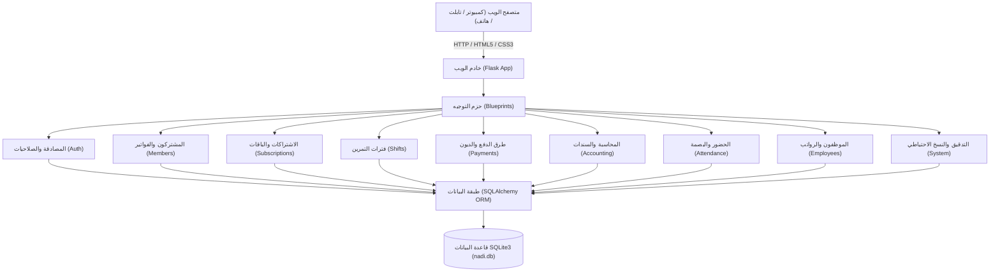
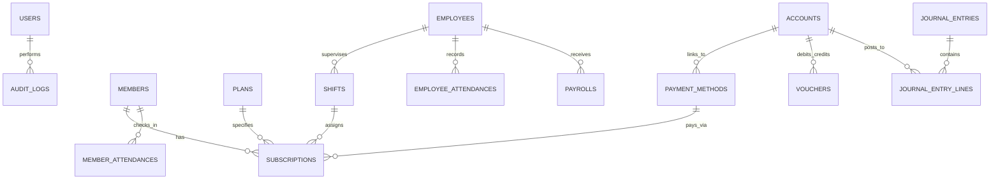

# 📖 دليل التوثيق الشامل لمنظومة «النادي اليمني الصحي»
### نظام إدارة الصالات الرياضية، كمال الأجسام، اللياقة البدنية، والشؤون المالية والمحاسبية المتكاملة

> **تطوير وتصميم:** **يمن كود لتصميم الأنظمة والبرمجيات الحديثة**  
> **حقوق الفواتير الحرارية:** **يمن كود للبرمجيات**  
> **اسم المنظومة:** **النادي اليمني الصحي (Yemeni Health Club Management System)**  
> **الإصدار:** 2.0.0 (Titanium Fire Edition)  
> **تاريخ التوثيق:** 2026-10-28

---

## 📑 فهرس المحتويات
1. [نظرة عامة على النظام](#1-نظرة-عامة-على-النظام)
2. [المعمارية التقنية والهوية البصرية](#2-المعمارية-التقنية-والهوية-البصرية)
3. [دليل الأقسام والشاشات بالتفصيل](#3-دليل-الأقسام-والشاشات-بالتفصيل)
   - [3.1 لوحة التحكم والمؤشرات الحيوية](#31-لوحة-التحكم-والمؤشرات-الحيوية)
   - [3.2 إدارة المشتركين والبطاقات الذكية](#32-إدارة-المشتركين-والبطاقات-الذكية)
   - [3.3 باقات واشتراكات النادي](#33-باقات-واشتراكات-النادي)
   - [3.4 فترات التمرين اليومية والكباتن](#34-فترات-التمرين-اليومية-والكباتن)
   - [3.5 أنواع وطرق الدفع المتعددة](#35-أنواع-وطرق-الدفع-المتعددة)
   - [3.6 الدفع الجزئي وتسجيل الديون وسدادها](#36-الدفع-الجزئي-وتسجيل-الديون-وسدادها)
   - [3.7 نظام الفواتير الحرارية المزدوجة (POS 80mm)](#37-نظام-الفواتير-الحرارية-المزدوجة-pos-80mm)
   - [3.8 بوابة الحضور السريع الذكية](#38-بوابة-الحضور-السريع-الذكية)
   - [3.9 شؤون الموظفين والمدربين والبصمة والرواتب](#39-شؤون-الموظفين-والمدربين-والبصمة-والرواتب)
   - [3.10 النظام المحاسبي والمالي المتكامل](#310-النظام-المحاسبي-والمالي-المتكامل)
   - [3.11 مركز الإشعارات والتنبيهات](#311-مركز-الإشعارات-والتنبيهات)
   - [3.12 سجل التدقيق الرقابي والنسخ الاحتياطي](#312-سجل-التدقيق-الرقابي-والنسخ-الاحتياطي)
   - [3.13 التقارير الدورية (يومية · أسبوعية · شهرية)](#313-التقارير-الدورية-يومية--أسبوعية--شهرية)
   - [3.14 الموازنة اليومية ومطابقة صندوق الدخل والخرج](#314-الموازنة-اليومية-ومطابقة-صندوق-الدخل-والخرج)
   - [3.15 دعم تطبيقات الويب التقدمية (PWA) والتثبيت والعمل بدون اتصال](#315-دعم-تطبيقات-الويب-التقدمية-pwa-والتثبيت-والعمل-بدون-اتصال)
4. [هيكل قاعدة البيانات والجداول](#4-هيكل-قاعدة-البيانات-والجداول)
5. [خريطة المسارات والروابط (Routes & URLs)](#5-خريطة-المسارات-والروابط-routes--urls)
6. [دليل التثبيت والتشغيل المحلي](#6-دليل-التثبيت-والتشغيل-المحلي)
7. [بيانات تسجيل الدخول الافتراضية وإرشادات الأمان](#7-بيانات-تسجيل-الدخول-الافتراضية-وإرشادات-الأمان)

---

## 1. نظرة عامة على النظام

منظومة **«النادي اليمني الصحي»** هي منصة ويب متطورة مصممة خصيصاً لإدارة وتشغيل الصالات الرياضية ومراكز اللياقة البدنية وبناء الأجسام في اليمن والمنطقة العربية. تدمج المنظومة بين سلاسة إدارة اللاعبين والكباتن واستقبال المشتركين، وبين دقة الإدارة المالية والمحاسبية الاحترافية، مع توفير دعم كامل لطباعة الفواتير الحرارية فور التسجيل بنسختين للمطابقة، ومتابعة الديون والتحصيلات، ومسير الرواتب بالبصمة.

### الأهداف الأساسية:
* أتمتة دورة حياة المشترك من لحظة التسجيل وحتى تجديد الاشتراك أو سداد المتبقي.
* ربط كل اشتراك بفترة تمرين محددة (صباحية، بعد العصر، مسائية) وكابتن مسؤول لضبط طاقة استيعاب الصالة.
* توفير طرق دفع عصرية تخدم البيئة اليمنية (كاش، محفظة الكريمي، محفظة جيب، ون كاش، جوالي، حوالات بنكية).
* إتاحة الدفع الجزئي وتسجيل المتبقي كدين بذمة المشترك مع إمكانية سداد الديون على دفعات.
* إصدار فواتير حرارية POS قياس 80mm تتضمن نسختين (نسخة للمشترك ونسخة للإدارة) للمطابقة والأرشيف.
* توفير نظام مالي ومحاسبي كامل (شجرة حسابات خماسية، سندات قبض وصرف، قيود يومية، دفتر أستاذ).
* العمل محلياً (Offline-First) بسرعة استجابة فائقة دون الحاجة لاتصال دائم بالإنترنت.

---

## 2. المعمارية التقنية والهوية البصرية



### 1.2 التقنيات المستخدمة
* **بيئة التشغيل الخلفية (Backend):** Python 3.10+ مع إطار العمل السريع والخفيف `Flask`.
* **طبقة إدارة البيانات (ORM):** `SQLAlchemy` للتعامل الآمن مع قواعد البيانات مع معالجة الهجرة التلقائية للأعمدة (`ALTER TABLE`).
* **قاعدة البيانات (Database):** `SQLite 3` (`nadi.db`) محلية، موثوقة، ذات أداء سريع ولا تحتاج لإدارة خوادم قواعد بيانات معقدة.
* **إدارة الجلسات والأمان:** `Flask-Login` لإدارة جلسات المشرفين، و `Flask-WTF` لحماية النماذج من هجمات CSRF، و `Werkzeug` لتشفير كلمات المرور عبر `pbkdf2:sha256`.
* **محرك العرض (Templating):** `Jinja2` مع معمارية القالب الأساسي الموحد (`base.html`).

### 2.2 الهوية البصرية وتجربة المستخدم (UI/UX)
* **ثيم التيتانيوم الناري (Titanium Fire Theme):** تصميم رياضي مستوحى من صالات الحديد وعالم كمال الأجسام، يعتمد على اللون البرتقالي الناري الحيوي مع رماديات التيتانيوم الداكنة ليعكس القوة والنشاط.
* **الخط العربي المعتمد:** خط **Cairo** المتميز في جميع عناصر الموقع بأوزانه المتدرجة (من 400 إلى 900) لتحقيق قراءة مريحة ودقيقة.
* **الوضعان الليلي والنهاري (Dark & Light Mode):** دعم كامل للتبديل بين الوضعين، مع مراعاة التباين اللوني العالي (WCAG AAA) في الوضع النهاري لتكون الخطوط سوداء فاحمة والنصوص شديدة الوضوح.
* **حفظ التفضيلات:** يتم تخزين اختيار الوضع المفضل في `localStorage` للمتصفح ليظل ثابتاً عبر جميع الجلسات.

---

## 3. دليل الأقسام والشاشات بالتفصيل

### 3.1 لوحة التحكم والمؤشرات الحيوية
* **الرابط:** `/dashboard/`
* **الوظيفة:** مركز القيادة اللحظي لإدارة النادي، ويعرض:
  * إجمالي عدد المشتركين المسجلين في النادي.
  * عدد الاشتراكات النشطة والسارية حالياً.
  * عدد الحضور المسجل لليوم الحالي.
  * إجمالي المقبوضات والإيرادات المالية للفترة الحالية.
  * رسوم بيانية تفاعلية لإحصائيات الحضور الأسبوعي وتوزيع المشتركين على الباقات وفترات التمرين.
  * تنبيهات سريعة للاشتراكات التي شارفت على الانتهاء.

---

### 3.2 إدارة المشتركين والبطاقات الذكية
* **الرابط:** `/members/`
* **الوظيفة:** إدارة ملفات اللاعبين وتاريخهم الرياضي:
  * **تسجيل مشترك جديد:** إدخال الاسم، الهاتف، الجنس، تاريخ الميلاد، العنوان، جهة اتصال الطوارئ، وملاحظات اللياقة أو الحالة الصحية.
  * **الاشتراك الفوري:** إمكانية ربط المشترك الجديد مباشرة بباقة اشتراك، وفترة تمرين، وطريقة دفع، مع تسجيل دفعة نقدية واحتساب المتبقي.
  * **تاريخ بدء الاشتراك:** إمكانية تحديد تاريخ بدء لاحق، أو تركه فارغاً ليبدأ تلقائياً من تاريخ اليوم.
  * **البطاقة الرقمية الذكية (Digital Member Pass):** تصميم عصري لبطاقة عضوية رقمية تحمل اسم «النادي اليمني الصحي»، كود العضوية، نوع الاشتراك، فترة التمرين، ورمز QR فريد.
  * **المشاركة عبر واتساب (WhatsApp Share):** زر مباشر لمشاركة بيانات البطاقة وكود العضوية مع اللاعب عبر محادثة واتساب بنقرة واحدة.
  * **سجل الاشتراكات والحضور:** عرض تاريخ كافة الاشتراكات السابقة والحالية، وجدول يوثق كل زيارة دخول وتمرين قام بها اللاعب.

---

### 3.3 باقات واشتراكات النادي
* **الروابط:**
  * إدارة الاشتراكات: `/subscriptions/`
  * أنواع الباقات: `/subscriptions/plans`
* **الوظيفة:**
  * تهيئة باقات النادي (مثل: يومي، أسبوعي، شهري، 3 أشهر، VIP) مع تحديد عدد الأيام والسعر الرسمي بالريال اليمني.
  * إنشاء اشتراكات جديدة للاعبين المسجلين مسبقاً.
  * الفرز والتصفية الذكية: حسب حالة الاشتراك (ساري، منتهي، ملغي) أو بالبحث باسم المشترك ورقمه.
  * إمكانية إلغاء الاشتراك مع توثيق سبب الإلغاء في سجل التدقيق.

---

### 3.4 فترات التمرين اليومية والكباتن
* **الرابط:** `/shifts/`
* **الوظيفة:** تنظيم أوقات الصالة لمنع الازدحام وتوزيع اللاعبين:
  * **فترات محددة مسبقاً:**
    1. **الفترة الصباحية:** من 06:00 صباحاً إلى 11:00 صباحاً (لحرق الدهون واللياقة).
    2. **فترة بعد العصر:** من 04:00 عصراً إلى 07:30 مساءً (تمارين الحديد وبناء الأجسام).
    3. **فترة المساء:** من 08:00 مساءً إلى 11:30 ليلاً (تمارين الأبطال والمكثفة).
  * **ربط الكابتن المسؤول:** ربط كل فترة بموظف/مدرب من كادر النادي ليكون مسؤولاً عن الصالة ومتابعة المتدربين أثناء فترته.
  * **ربط الاشتراكات:** يحدد كل مشترك فترته المفضلة عند الاشتراك لتظهر في بطاقته الرقمية وفاتورته.

---

### 3.5 أنواع وطرق الدفع المتعددة
* **الرابط:** `/payments/methods`
* **الوظيفة:** إدارة وسائل تحصيل الرسوم والاشتراكات:
  * وسائل دفع جاهزة ومعدة مسبقاً تناسب السوق اليمني:
    * **كاش (نقداً):** الدفع المباشر في خزينة النادي (الصندوق الرئيسي).
    * **محفظة الكريمي (Kurimi Pay):** الدفع عبر حساب أو تطبيق الكريمي جوال.
    * **محفظة جيب (Jeep):** الدفع عبر محفظة جيب الإلكترونية.
    * **محفظة ون كاش (OneCash):** الدفع عبر خدمة ون كاش.
    * **محفظة جوالي:** الدفع عبر محفظة جوالي.
    * **حوالة / تحويل بنكي:** إيداع أو حوالة مصرفية مباشرة.
  * إضافة أي وسيلة دفع جديدة بكود مخصص وربطها بالحساب المالي المقابل.
  * بطاقات إحصائية تبرز إجمالي المبالغ المحصلة عبر كل طريقة وعدد العمليات المنفذة بها.

---

### 3.6 الدفع الجزئي وتسجيل الديون وسدادها
* **كيف يعمل الدفع الجزئي؟**
  1. عند إنشاء مشترك أو اشتراك، يُعرض سعر الباقة الرسمي تلقائياً.
  2. يقوم موظف الاستقبال بإدخال المبلغ الذي سدده المشترك حالياً في حقل `المبلغ المدفوع`.
  3. يقوم النظام تلقائياً وبشكل حي بحساب:
     $$\text{المتبقي} = \text{سعر الباقة} - \text{المبلغ المدفوع}$$
  4. إذا كان المتبقي أكبر من الصفر:
     * يُسجل المتبقي كدين بذمة المشترك (`remaining_amount`).
     * تُعين حالة الدفع على: **«مدفوع جزئياً»**.
     * ينشئ النظام سند قبض مالي رسمي بقيمة المبلغ المدفوع فعلياً.
  5. إذا سدد المشترك كامل المبلغ، تصبح الحالة: **«مدفوع بالكامل (خالص)»**.
* **متابعة وسداد الديون:**
  * يظهر عمود **«الرصيد / المتبقي»** بلون أحمر تحذيري في جدول المشتركين وجدول الاشتراكات.
  * في ملف المشترك تظهر بطاقة تحذيرية: `⚠️ متبقي مالي بذمة المشترك (ديون اشتراكات)`.
  * زر **«💵 سداد المتبقي»**: يتيح سداد المبلغ المتبقي (أو جزء منه) في أي وقت، واختيار وسيلة الدفع، وإصدار سند قبض فوري، وتصفية الدين عند اكتماله.

---

### 3.7 نظام الفواتير الحرارية المزدوجة (POS 80mm)
* **الرابط:** `/members/<member_id>/receipt`
* **المواصفات والخصائص:**
  * مصممة بمقاس الفواتير الحرارية القياسي (طابعات الإيصالات **80mm POS**).
  * تعمل بنظام الطباعة المزدوجة (**نسختين في نفس عملية الطباعة**):
    1. **نسخة المشترك (العضوية):** يستلمها المشترك كإثبات سداد وبطاقة اشتراك.
    2. **نسخة الإدارة (للمطابقة والأرشيف):** تبقى في صندوق النادي للمطابقة المحاسبية اليومية.
  * يفصل بين النسختين خط قص ورقي واضح مزود برمز المقص: `✂️ قص هنا / CUT HERE ✂️`.
  * **البيانات الواردة في كل نسخة:**
    * ترويسة: **🔥 النادي اليمني الصحي 🔥** مع الهاتف والعنوان.
    * رقم الفاتورة المشفر وتاريخ ووقت الإصدار واسم الموظف المنفذ.
    * بيانات المشترك: الاسم، كود العضوية، الهاتف، الجنس، العنوان، جهة الطوارئ.
    * بيانات الاشتراك: نوع الباقة، مدتها، فترة التمرين، توقيتها، الكابتن المسؤول، تاريخ البدء والانتهاء.
    * البيانات المالية: طريقة الدفع (كاش، محفظة الكريمي، جيب...)، السعر الإجمالي، المبلغ المقبوض، المتبقي (الدين)، وحالة السداد.
    * تمثيل باركود بصري لكود العضوية.
    * شروط وتعليمات الصالة والالتزام الرياضي.
    * خانتا توقيع: توقيع المشترك، وتوقيع وختم الإدارة.
    * تذييل الحقوق الرسمي المعتمد: **«يمن كود للبرمجيات»**.
  * **الطباعة التلقائية (Auto-Print):** بمجرد إنشاء مشترك أو تفعيل اشتراك، يُحول المستخدم لصفحة الفاتورة وتبدأ الطابعة بالطباعة تلقائياً دون الحاجة للنقر على أي زر.
  * **إعادة الطباعة:** زر «🖨️ طباعة الفاتورة الحرارية» متاح دائماً في ملف المشترك وفي شاشة الاشتراكات.

---

### 3.8 بوابة الحضور السريع الذكية
* **الرابط:** `/member-attendance/`
* **الوظيفة:** تسجيل دخول المشتركين للتمارين اليومية:
  * إدخال كود المشترك أو مسح رمز الباركود/QR.
  * التحقق الآني من سريان الاشتراك وصلاحيته وفترة التمرين الحالية.
  * إظهار رسالة ترحيبية بصورة المشترك وحالة اشتراكه فورياً (ساري بالأخضر، أو منتهي بالأحمر).
  * تسجيل الحركة في جدول الحضور مع الطابع الزمني بالثانية.

---

### 3.9 شؤون الموظفين والمدربين والبصمة والرواتب
* **الروابط:**
  * ملفات الموظفين: `/employees/`
  * سجل دوام البصمة: `/employees/attendance`
  * مسير الرواتب: `/employees/payroll`
* **الوظيفة:**
  * ملف شامل لكل موظف ومدرب (الاسم، الوظيفة، الهاتف، الراتب الأساسي، تاريخ التعيين).
  * تسجيل حضور وانصراف الموظفين، مع إمكانية استيراد ملفات حركات البصمة مباشرة عبر ملفات `CSV`.
  * إعداد مسير الرواتب الشهري مع احتساب البدلات، المكافآت، والخصومات، وتوليد سند صرف مالي لكل راتب مع طباعة كشف مسير الرواتب الرسمي.

---

### 3.10 النظام المحاسبي والمالي المتكامل
* **الروابط:**
  * شجرة الحسابات: `/accounting/accounts`
  * سندات القبض والصرف: `/accounting/vouchers`
  * القيود اليومية: `/accounting/journal`
  * دفتر الأستاذ العام: `/accounting/ledger`
* **الوظيفة:**
  * **دليل محاسبي شجري خماسي المستويات:**
    * `1` الأصول (الصندوق الرئيسي، البنك، مدينو الاشتراكات، الأجهزة والمعدات الرياضية).
    * `2` الخصوم والالتزامات (مستحقات الموظفين، أمانات المشتركين، الدائنون).
    * `3` حقوق الملكية (رأس مال النادي، الأرباح المبقاة).
    * `4` الإيرادات (إيرادات الاشتراكات، التدريب الشخصي، مبيعات المشروبات).
    * `5` المصروفات (رواتب الكباتن، إيجار المقر، فواتير الكهرباء والمياه، صيانة الأجهزة الرياضية).
  * **سندات القبض والصرف (Vouchers):** توثيق كل تدفق مالي داخل أو خارج الصندوق، مع إمكانية الطباعة.
  * **القيود اليومية الآلية:** كل سند اشتراك أو راتب يولد تلقائياً قيداً يومياً متزناً (مدين ودائن).
  * **دفتر الأستاذ (كشف حساب):** استخراج كشف حساب تفصيلي لأي حساب مالي خلال أي فترة زمنية.

---

### 3.11 مركز الإشعارات والتنبيهات
* **الرابط:** `/notifications/`
* **الوظيفة:**
  * رصد الاشتراكات التي ستنتهي قريباً (خلال 7 أيام افتراضياً) لتذكير اللاعب بالتجديد.
  * رصد الاشتراكات المنتهية ومتابعة تجديدها.
  * تنبيهات الديون والمتبقيات المالية المتأخرة.
  * تخصيص قواعد التنبيه حسب سياسة النادي من شاشة `/notifications/rules`.

---

### 3.12 سجل التدقيق الرقابي والنسخ الاحتياطي
* **الروابط:**
  * سجل التدقيق: `/system/audit`
  * النسخ الاحتياطي: `/system/backup`
* **الوظيفة:**
  * **سجل الرقابة والأمان (Audit Log):** توثيق كل حركة في النظام (إنشاء مشترك، تعديل، تجديد اشتراك، إلغاء، سداد متبقي، حذف) مع هوية المستخدم، التاريخ، الوقت، وعنوان IP.
  * **النسخ الاحتياطي الفوري (Database Backup):** تنزيل نسخة احتياطية كاملة من قاعدة بيانات النادي (`nadi_backup_YYYYMMDD.db`) بنقرة زر واحدة لحفظ البيانات في مكان آمن، مع إمكانية استعادة النسخ في أي وقت.

---

### 3.13 التقارير الدورية (يومية · أسبوعية · شهرية)
* **الرابط:** `/reports/`
* **الوظيفة:**
  * توفير مركز تقارير تحليلي متكامل بضغطة زر واحدة بفترات زمنية محددة:
    * **تقرير اليوم (Daily):** أداء وحركة اليوم اللحظية.
    * **تقرير الأسبوع (Weekly):** آخر 7 أيام ومتابعة نمو الاشتراكات.
    * **تقرير الشهر (Monthly):** من بداية الشهر الحالي وحتى اليوم لمطابقة الإيرادات الشهرية.
    * **فترة مخصصة (Custom Range):** تحديد أي تاريخين (من تاريخ - إلى تاريخ).
  * **المؤشرات المعروضة في التقرير:**
    * إجمالي الدخل والمقبوضات المالية.
    * إجمالي الخرج والمصروفات التشغيلية.
    * صافي الأرباح والفائض المالي للفترة.
    * إجمالي مبالغ الديون والمتبقيات المسجلة.
    * عدد المشتركين الجدد وعدد الاشتراكات المفعلة والمجددة.
    * عدد زيارات التمارين الرياضية المسجلة.
    * جداول تفصيلية لتوزيع الإيرادات حسب وسيلة الدفع، وحسب باقات النادي، وحسب فترات التمرين اليومية.
    * سجل كامل لسندات القبض والصرف المحررة خلال الفترة مع إمكانية الطباعة الرسمية.

---

### 3.14 الموازنة اليومية ومطابقة صندوق الدخل والخرج
* **الروابط:**
  * شاشة الموازنة: `/reports/daily-balance`
  * إيصال الموازنة الحراري (80mm): `/reports/daily-balance/thermal`
* **الوظيفة:**
  * حساب ومطابقة التدفقات المالية اليومية (الدخل مقابل الخرج).
  * **قائمة مقبوضات اليوم:** تفصيل كل سند قبض، اسم المشترك، طريقة السداد، والمبلغ.
  * **قائمة مدفوعات اليوم:** تفصيل كل سند صرف، الحساب المصروف عليه، والبيان.
  * **حساب الرصيد الصافي اللحظي:** الدخل - الخرج = الفائض أو العجز.
  * **مطابقة وتسوية صندوق الخزينة (Cash Drawer Settlement):**
    * حساب النقدية المفترض وجودها في الدرج تلقائياً (المقبوض كاش - المصروف كاش).
    * حقل لإدخال الجرد الفعلي للنقد الموجود في الدرج نهاية الوردية أو اليوم.
    * حساب الفارق تلقائياً وإصدار تنبيه فوري: (مطابق تماماً 100%، أو عجز في الصندوق، أو زيادة).
  * **خيارات الطباعة:**
    * طباعة إيصال موازنة حراري (80mm) لقصّه وتدبيسه مع مظروف نقدية الوردية وحفظه في الأرشيف.
    * طباعة تقرير موازنة رسمي بحجم A4 مع خانات توقيع أمين الصندوق، المراجع المالي، واعتماد المدير.

---

### 3.15 دعم تطبيقات الويب التقدمية (PWA) والتثبيت والعمل بدون اتصال
* **المواصفات التقنية:**
  * **ملف البيان (Web App Manifest):** `/static/manifest.json` بتعريف كامل للهوية النارية الرياضية، الألوان، شاشات البدء، والأيقونات.
  * **الأيقونات المعتمدة:** أيقونات فائقة الدقة بصيغة PNG بمقاسات `192x192` و `512x512` قابلة للتحجيم والقناع (Maskable) تحمل شعار التيتانيوم الناري للنادي.
  * **عامل الخدمة (Service Worker):** `/sw.js` يعمل كخادم وكيل محلي لتخزين الملفات الثابتة (CSS, Fonts, Icons) وتقديم صفحة عدم الاتصال `/offline` عند انقطاع الشبكة.
  * **زر التثبيت الفوري (📲 تثبيت التطبيق):** يظهر تلقائياً في شريط العنوان العلوي للمتصفح والأجهزة الذكية عند إمكانية التثبيت.
  * **طبيعة العمل:** يتيح للمشرفين وموظفي الاستقبال تثبيت النظام كتطبيق مستقل (Standalone App) على شاشات سطح مكتب ويندوز أو الهواتف والأجهزة اللوحية دون ظهور أشرطة المتصفح، مع سرعة تشغيل فائقة.

---

## 4. هيكل قاعدة البيانات والجداول



### ملخص الجداول الرئيسية:
1. `users`: بيانات المستخدمين ومدراء النظام وكلمات المرور المشفرة.
2. `members`: بيانات اللاعبين والمشتركين والاتصال والطوارئ.
3. `plans`: باقات الاشتراكات ومدتها بالايام وسعرها.
4. `shifts`: فترات التمرين (صباح، عصر، مساء) وساعاتها والمشرف عليها.
5. `payment_methods`: طرق الدفع (كاش، محفظة الكريمي، جيب، تحويل...).
6. `subscriptions`: سجل الاشتراكات، فترات البدء والانتهاء، المبالغ، والديون.
7. `member_attendances`: سجل حضور اللاعبين اليومي للتمارين.
8. `employees`: كادر النادي والمدربين والرواتب.
9. `employee_attendances`: سجل دوام البصمة للموظفين.
10. `payrolls`: مسيرات الرواتب الشهرية والبدلات والخصومات.
11. `accounts`: الدليل المحاسبي وشجرة الحسابات.
12. `vouchers`: سندات القبض والصرف المالية.
13. `journal_entries` & `journal_entry_lines`: قيود اليومية المحاسبية المزدوجة.
14. `notification_rules` & `notifications`: مركز التنبيهات وقواعدها.
15. `audit_logs`: سجل التدقيق الرقابي لجميع عمليات النظام.

---

## 5. خريطة المسارات والروابط (Routes & URLs)

| المسار (URL) | الطريقة | الوصف والوظيفة |
|---|---|---|
| `/` | GET | تحويل تلقائي للوحة التحكم الرئيسية |
| `/auth/login` | GET, POST | تسجيل الدخول للنظام |
| `/auth/logout` | GET | تسجيل الخروج الآمن |
| `/dashboard/` | GET | لوحة التحكم والمؤشرات الإحصائية |
| `/members/` | GET, POST | قائمة المشتركين + نافذة إضافة مشترك واشتراك فوري |
| `/members/<id>` | GET | الملف الشخصي للمشترك، البطاقة الرقمية، والاشتراكات |
| `/members/<id>/edit` | POST | تعديل بيانات المشترك والاتصال |
| `/members/<id>/receipt` | GET | **طباعة الفاتورة الحرارية المزدوجة (نسختين 80mm)** |
| `/subscriptions/` | GET, POST | إدارة الاشتراكات وتفعيل اشتراك جديد |
| `/subscriptions/<id>/cancel` | POST | إلغاء اشتراك وتوثيق السبب |
| `/subscriptions/<id>/pay-remaining` | POST | **سداد المتبقي (الدين) على الاشتراك وإصدار سند قبض** |
| `/subscriptions/plans` | GET, POST | إدارة أنواع وباقات الاشتراكات |
| `/shifts/` | GET, POST | إدارة فترات التمرين اليومية والكباتن |
| `/shifts/<id>/toggle` | POST | تفعيل / تعطيل فترة تمرين |
| `/shifts/<id>/edit` | POST | تعديل أوقات أو مشرف فترة التمرين |
| `/payments/methods` | GET, POST | **إدارة أنواع وطرق الدفع والربط المالي** |
| `/payments/methods/<id>/toggle`| POST | تفعيل أو تعطيل وسيلة دفع |
| `/payments/methods/<id>/edit` | POST | تعديل بيانات وسيلة الدفع والحساب المالي |
| `/member-attendance/` | GET, POST | بوابة الحضور السريع بمسح الكود أو الرقم |
| `/employees/` | GET, POST | ملفات المدربين والموظفين |
| `/employees/attendance` | GET, POST | دوام البصمة واستيراد CSV |
| `/employees/payroll` | GET, POST | مسير الرواتب الشهري والطباعة |
| `/accounting/accounts` | GET, POST | شجرة الحسابات المالية |
| `/accounting/vouchers` | GET, POST | سندات القبض والصرف |
| `/accounting/journal` | GET | القيود اليومية المحاسبية |
| `/accounting/ledger` | GET | كشف حساب دفتر الأستاذ العام |
| `/notifications/` | GET | مركز الإشعارات والتنبيهات |
| `/reports/` | GET | **التقارير التحليلية والمالية (يومي · أسبوعي · شهري · مخصص)** |
| `/reports/daily-balance` | GET | **الموازنة اليومية ومطابقة صندوق الدخل والخرج** |
| `/reports/daily-balance/thermal` | GET | **إيصال الموازنة وإغلاق الصندوق الحراري (80mm)** |
| `/offline` | GET | صفحة العمل بدون اتصال لتقنية PWA |
| `/sw.js` | GET | مشغل عامل الخدمة (PWA Service Worker) |
| `/system/audit` | GET | سجل التدقيق الرقابي للعمليات |
| `/system/backup` | GET, POST | أخذ نسخة احتياطية من قاعدة البيانات وتنزيلها |

---

## 6. دليل التثبيت والتشغيل المحلي

### المتطلبات المسبقة:
* نظام تشغيل: Windows 10/11 أو Linux أو macOS.
* تثبيت مسبق للغة: `Python 3.10` أو أحدث.

### خطوات التثبيت والتشغيل:
1. **فتح موجه الأوامر (Terminal / PowerShell)** في مجلد المشروع:
   ```powershell
   cd E:\gym
   ```
2. **إنشاء وتفعيل بيئة افتراضية (اختياري لكن مفضل):**
   ```powershell
   python -m venv venv
   .\venv\Scripts\activate
   ```
3. **تثبيت الحزم البرمجية المطلوبة:**
   ```powershell
   pip install -r requirements.txt
   ```
4. **تشغيل الخادم المحلي:**
   ```powershell
   python run.py
   ```
5. **فتح المتصفح:**
   انتقل إلى الرابط التالي:  
   👉 **`http://127.0.0.1:5000`**

---

## 7. بيانات تسجيل الدخول الافتراضية وإرشادات الأمان

تم تهيئة حسابين إداريين افتراضياً للوصول للنظام:

| الحساب | اسم المستخدم | كلمة المرور | الدور والصلاحية |
|---|---|---|---|
| الحساب الرئيسي | `771597106` | `771597106mokhtar` | مدير النظام (مختار علوي) |
| الحساب الثانوي | `admin` | `admin123` | مدير النظام العام |

### إرشادات الأمان والتشغيل في النادي:
1. **تغيير كلمات المرور:** يُنصح بتغيير كلمات المرور الافتراضية فور استلام المنظومة من شاشة `/auth/profile`.
2. **النسخ الاحتياطي الدوري:** يوصى بأخذ نسخة احتياطية من قاعدة البيانات يومياً أو أسبوعياً من شاشة `/system/backup` وحفظها على قرص خارجي (فلاش ميموري).
3. **طابعات الفواتير الحرارية:** عند توصيل طابعة فواتير حرارية 80mm، اضبط حجم الورق في إعدادات الطباعة على `80mm` أو `Roll Paper 80 x 297 mm` وتفعيل خيار «الرسومات في الخلفية (Background graphics)» للحصول على أفضل وضوح.

---

> **حقوق الملكية الفكرية:**  
> تم بناء وتطوير المنظومة بالكامل بواسطة:  
> **«يمن كود لتصميم الأنظمة والبرمجيات الحديثة»**  
> وحقوق الفاتورة الحرارية: **«يمن كود للبرمجيات»**  
> لصالح: **«النادي اليمني الصحي»**
